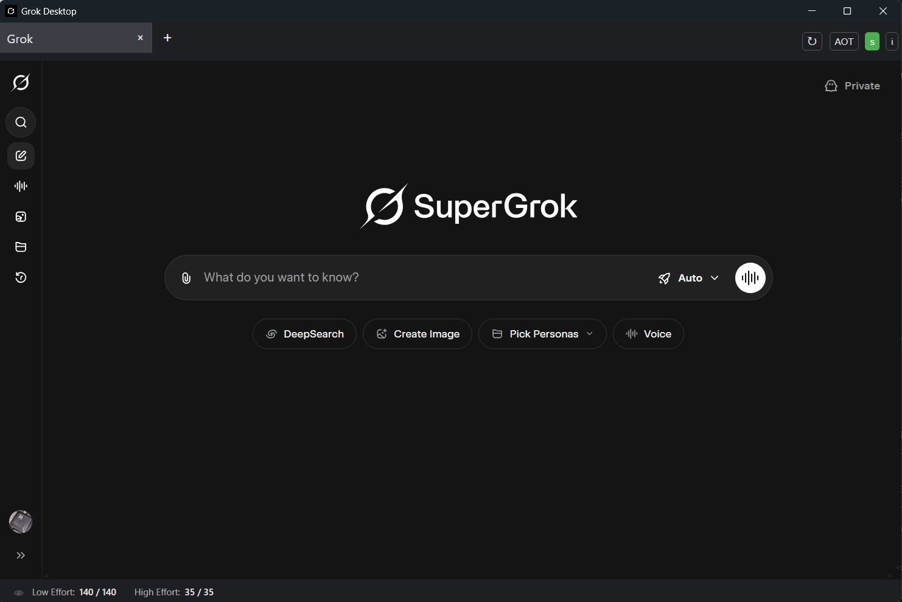

# Grok-Desktop v1.3.0

## Description
Grok-Desktop is an Electron-based desktop application for Windows 10/11 and Linux that wraps `grok.com`, providing desktop-application-like access to Grok with real-time API usage monitoring, multi-tab support, and authentication for xAI/X, Google, Apple and GitHub accounts.

## Sponsor
Development of Grok-Desktop is sponsored by [Firmicom](https://www.firmicom.com/). See the [Grok Desktop product page](https://www.firmicom.com/grok-desktop/) for an overview and live download statistics.

## Screenshot


## Features
- **Desktop application wrapper** for grok.com
- **Tabs functionality** for multiple Grok conversations
- **Real-time Usage Monitoring** - Track your Grok usage limits:
  - **Low Effort**: Basic query limits and remaining tokens
  - **High Effort**: Advanced feature usage tracking
  - **Grok 4 Heavy**: Specialized model usage limits
  - **Refill Timer**: Shows when limits reset
- **Keyboard shortcuts**:
  - `Ctrl+T`: Open a new tab
  - `Ctrl+Tab` / `Ctrl+Shift+Tab`: Cycle through open tabs (next/previous)
  - `Mouse-wheel-scroll`: Scroll open tabs when they are overflowing on the tab bar
  - `Ctrl+Mouse-wheel-scroll`: Cycle through open tabs (next/previous)
  - `Ctrl+R`: Reload the active tab
  - `Ctrl+I`: Show information/about dialog
- **Authentication support** for xAI/X, Google, Apple and GitHub accounts, with sign-in and sign-out kept in the app
- **Clean interface** with no menu bar for distraction-free usage
- **Always-on-top function** with cross-platform support (Windows & Linux)
- **Dark/Light mode support** with system theme detection
- **Grok speech mode** support
- **Enhanced security** with domain validation and OAuth protection

## Download

Version 1.3.0 includes the maintainer's verified Windows VM authentication and sign-out fixes. Download one of the nine Windows/Linux packages below.

### Windows
- [Grok-Desktop_Installer-v1.3.0.exe](https://github.com/AnRkey/Grok-Desktop/releases/download/v1.3.0/Grok-Desktop_Installer-v1.3.0.exe) - Windows installer (EXE)
- [Grok-Desktop_Installer-v1.3.0.msi](https://github.com/AnRkey/Grok-Desktop/releases/download/v1.3.0/Grok-Desktop_Installer-v1.3.0.msi) - Windows installer (MSI)
- [Grok-Desktop_Portable-v1.3.0.exe](https://github.com/AnRkey/Grok-Desktop/releases/download/v1.3.0/Grok-Desktop_Portable-v1.3.0.exe) - Portable Windows executable
- [Grok-Desktop_Windows-v1.3.0.zip](https://github.com/AnRkey/Grok-Desktop/releases/download/v1.3.0/Grok-Desktop_Windows-v1.3.0.zip) - Windows ZIP archive
- [Grok-Desktop_Windows-v1.3.0.7z](https://github.com/AnRkey/Grok-Desktop/releases/download/v1.3.0/Grok-Desktop_Windows-v1.3.0.7z) - Windows 7z archive

### Linux
- [Grok-Desktop-v1.3.0.deb](https://github.com/AnRkey/Grok-Desktop/releases/download/v1.3.0/Grok-Desktop-v1.3.0.deb) - Debian/Ubuntu package
- [Grok-Desktop-v1.3.0.rpm](https://github.com/AnRkey/Grok-Desktop/releases/download/v1.3.0/Grok-Desktop-v1.3.0.rpm) - RPM package (RHEL/Rocky Linux/Fedora)
- [Grok-Desktop_Linux-v1.3.0.tar.gz](https://github.com/AnRkey/Grok-Desktop/releases/download/v1.3.0/Grok-Desktop_Linux-v1.3.0.tar.gz) - Linux tar.gz archive
- [Grok-Desktop_Linux-v1.3.0.7z](https://github.com/AnRkey/Grok-Desktop/releases/download/v1.3.0/Grok-Desktop_Linux-v1.3.0.7z) - Linux 7z archive

All packages target x64. The ZIP/7z/tar.gz files contain the unpacked application; extract the entire archive before launching it.

## System Requirements

### For Using the Application
- **Operating System**: Windows 10/11 or Linux (Rocky Linux 9/10, RHEL 9, Ubuntu, Fedora, etc.)
- **Internet connection** for accessing grok.com
- **Grok account** (sign up in-app or use xAI/X, Google, Apple or GitHub authentication)
- **Linux AOT (Always-on-Top) requirement**: Install `wmctrl` for Always-on-Top functionality:
  - Rocky Linux/RHEL/Fedora: `sudo dnf install wmctrl`
  - Ubuntu/Debian: `sudo apt install wmctrl`

### For Building from Source
- **Operating System**: Windows 10/11 or Linux
- **Node.js**: LTS version (24.x required)
- **Internet connection** for downloading dependencies

## Project Structure
```
Grok-Desktop/
├── src/                    # Main Electron application code
│   ├── main.js            # Main Electron process
│   ├── preload.js         # Preload script for renderer security
│   ├── ui.js              # Application shell UI
│   ├── url-policy.js      # URL and GPU policies
│   ├── grok.ico           # Windows application icon
│   └── grok.png           # Linux application icon
├── assets/                # Static assets
│   ├── icon.png
│   └── icon.svg
├── build-resources/       # Build configuration and resources
│   ├── icons/            # Application icons for different sizes
│   ├── after-install.sh  # Post-installation script
│   ├── after-remove.sh   # Post-removal script
│   └── com.grok.desktop.metainfo.xml  # App metadata for Linux
├── index.html            # Main application HTML
├── styles.css            # Application styles
├── about.html            # About dialog HTML
├── package.json          # Node.js dependencies and build config
├── build.bat             # Windows build script
├── CHANGELOG.md          # Version history and changes
└── README.md            # This file
```


## Building from Source

### Prerequisites
1. Install Node.js LTS (24.x required) from [nodejs.org](https://nodejs.org/)
2. Clone this repository: `git clone https://github.com/AnRkey/Grok-Desktop.git`
3. Navigate to the project: `cd Grok-Desktop`
4. Install dependencies: `npm ci`

### Build Commands


#### Windows
```bash
# Full installer (NSIS + MSI)
npm run build-installer

# Portable executable
npm run build-portable

# Directory build (unpacked)
npm run build-dir

# ZIP and 7z archives of build/win-unpacked (requires 7-Zip)
powershell -NoProfile -ExecutionPolicy Bypass -File scripts/build-windows-archives.ps1
```

#### Linux
```bash
# RPM + DEB packages
npm run build-linux

# RPM only for RHEL/Rocky Linux
npm run build-rpm

# All platforms (Windows + Linux)
npm run build-all
```

**Notes:**
- Build scripts use the locked local `electron-builder`; publishing is disabled
- Build outputs are written to the `build/` directory
- `build.bat win` creates all five Windows package/archive types; install [7-Zip](https://www.7-zip.org/) first
- Run Linux packaging on Linux with `npm run build-linux`; the development workflow also creates DEB/RPM, Linux 7z and tar.gz archives
- `build.bat linux` creates all four Linux types in Docker; `build.bat all` runs both platform builds

## Installation

### Windows
1. Download and run `Grok-Desktop_Installer-v1.3.0.exe` from the releases page
2. Follow the installation wizard
3. Launch "Grok Desktop" from the Start Menu

### Linux

#### RPM Package (Recommended for RHEL/Rocky Linux)
```bash
cd build
sudo dnf install ./Grok-Desktop-v1.3.0.rpm
```

#### DEB Package (Debian/Ubuntu)
```bash
sudo apt install ./Grok-Desktop-v1.3.0.deb
```

## Usage Guide

### Getting Started
1. Launch Grok-Desktop from your applications menu or desktop shortcut
2. Sign in to grok.com using your xAI/X, Google, Apple or GitHub account
3. The application opens with your first Grok tab

### Interface Overview
- **Tab Bar**: Create and switch between multiple Grok conversations
- **Navigation Controls**: Reload button; back/forward/reload in the context menu
- **Toolbar Buttons**:
  - **+**: Create new tab
  - **↻**: Reload current tab
  - **AOT**: Toggle always-on-top mode
  - **s**: Toggle API usage statistics display
  - **👁**: Toggle Grok-4-Heavy stats visibility (eye icon)
  - **i**: Show about dialog

### API Usage Monitoring
Grok-Desktop includes real-time monitoring of your Grok API usage limits:

#### Usage Statistics Display
When enabled (click the **s** button), a status bar appears at the bottom showing:

- **Low Effort**: `remaining / total` - Basic query limits
- **High Effort**: `remaining / total` - Advanced feature usage
- **Grok 4 Heavy**: `remaining / total` - Specialized model limits
- **Refill**: Time until limits reset (when applicable)

#### Visual Indicators
- **Green**: Normal usage levels
- **Orange**: Warning (≤25% remaining)
- **Red**: Critical (≤10% remaining)

#### Features
- **Auto-refresh**: Updates every 5 seconds when active
- **Persistent settings**: Remembers your display preferences
- **Toggle controls**: Hide/show specific statistics as needed
- **Login detection**: Shows "Login required" when not authenticated

Thanks to Joshua Wang for his code.

### Keyboard Shortcuts
| Shortcut | Action |
|----------|--------|
| `Ctrl+T` | Open a new tab |
| `Ctrl+Tab` | Switch to next tab |
| `Ctrl+Shift+Tab` | Switch to previous tab |
| `Ctrl+R` | Reload active tab |
| `Ctrl+I` | Show information/about dialog |

### Always-on-Top Feature
- Click the **AOT** button to toggle always-on-top mode
- The button turns green when active
- On Linux, requires `wmctrl` package (automatically handled)

## Support & Troubleshooting

### Getting Help
Need help? Found a bug? Have a feature request?

[](https://github.com/AnRkey/Grok-Desktop/issues/new/choose)

#### When Reporting Issues
Please include:
1. **Operating System & Version**: e.g., "Rocky Linux 10 with GNOME 49"
2. **Application Version**: Found using the **i** button or `Ctrl+I`
3. **Steps to Reproduce**: Detailed step-by-step instructions
4. **Expected vs Actual Behavior**: What should happen vs what actually happens
5. **Screenshots**: If applicable, especially for UI issues
6. **Error Messages**: Copy any error messages from console/terminal
7. **System Details**: GPU, display server (X11/Wayland), etc.

Check [existing issues](https://github.com/AnRkey/Grok-Desktop/issues) first to avoid duplicates.

### Common Issues & Solutions

#### Always-on-Top Not Working on Linux
**Symptoms**: AOT button doesn't work on Rocky Linux/GNOME
**Solution**: Ensure `wmctrl` is installed:
```bash
# Rocky Linux/RHEL/Fedora
sudo dnf install wmctrl

# Ubuntu/Debian
sudo apt install wmctrl
```

#### Usage Statistics Not Showing
**Symptoms**: Clicking 's' button doesn't show usage data
**Solution**:
1. Ensure you're logged into Grok.com in the application
2. The feature requires an active Grok session to fetch API limits
3. If you see "Login required", sign in through the Grok tab
4. Statistics should appear automatically once authenticated

#### Application Won't Start
**Symptoms**: App fails to launch
**Solutions**:
- Check system requirements (4GB RAM minimum)
- Try running from terminal to see error messages
- On Linux, ensure required libraries are installed:
  ```bash
  sudo dnf install gtk3 libXScrnSaver alsa-lib nss
  ```

#### Build Fails on Linux
**Symptoms**: `npm run build-linux` fails
**Solutions**:
- Install build dependencies: `sudo dnf groupinstall "Development Tools"`
- For RPM builds on Rocky Linux 10: `sudo dnf install libxcrypt-compat`
- Run `npm ci` with Node.js 24 before building

### Providing Feedback
Your feedback helps improve Grok-Desktop! Here's how to contribute:

- **🐛 Bug Reports**: [Submit an issue](https://github.com/AnRkey/Grok-Desktop/issues/new?labels=bug&template=bug_report.md)
- **✨ Feature Requests**: [Submit an enhancement](https://github.com/AnRkey/Grok-Desktop/issues/new?labels=enhancement&template=feature_request.md)
- **💬 General Feedback**: Email anrkey@gmail.com with subject "Grok-Desktop Feedback"
- **📝 Documentation**: Help improve docs by submitting pull requests

All feedback is reviewed and considered for future updates. Thank you for helping make Grok-Desktop better!

## Technical Details

### Architecture
Grok-Desktop is built with:
- **Electron**: Cross-platform desktop app framework
- **Node.js**: Backend runtime
- **Web technologies**: HTML, CSS, JavaScript for the UI
- **Custom tabs**: Multi-tab interface using Electron's webview

### Security Features
- **Domain validation**: Prevents malicious subdomain attacks
- **OAuth protection**: In-app Google/Apple/xAI/X/GitHub authentication and cookie handoffs
- **External URL validation**: Blocks localhost/private IPs and validates protocols
- **CSP headers**: Content Security Policy for additional protection
- **Sandboxing**: Electron's security features enabled by default

### API Usage Monitoring System
Real-time tracking of Grok API usage limits via authenticated API calls:

#### Data Sources
- **Rate Limits API**: Fetches current usage data from `grok.com/rest/rate-limits`
- **Model-Specific Tracking**: Monitors both standard models and Grok-4-Heavy
- **Token-Based Calculations**: Displays remaining queries against total allowances

#### Technical Implementation
- **Session-Based Authentication**: Uses persistent Grok session cookies for API access
- **Parallel Fetching**: Concurrently retrieves multiple model limits for performance
- **Error Handling**: Graceful fallbacks when API is unavailable or authentication fails
- **Local Storage**: Remembers user preferences for display settings
- **Auto-Refresh**: Background updates every 5 seconds when monitoring is active

### Always-on-Top (AOT) Implementation
Cross-platform always-on-top functionality with automatic compatibility handling:

#### Windows Implementation
- Uses Electron's built-in `BrowserWindow.setAlwaysOnTop()` method
- Native Windows API integration

#### Linux Implementation
- **Primary**: Uses `wmctrl` command-line tool for reliable window management
- **Fallback**: Electron's `setAlwaysOnTop()` method when `wmctrl` unavailable
- **Display server**: `wmctrl` needs X11/XWayland; native Wayland window managers may restrict always-on-top behavior

#### Linux Dependencies
```bash
# Required for AOT functionality
sudo dnf install wmctrl    # Rocky Linux/RHEL/Fedora
sudo apt install wmctrl    # Ubuntu/Debian
```

### Recent Changes (v1.3.0)
- Electron 45.2.1, patched build dependencies, renderer isolation and guarded IPC
- In-app Google, Apple, X and GitHub sign-in and complete Grok sign-out
- Restored Inspect Element and background tabs for Grok search results
- Correct Windows GPU detection and AOT state; contributor handles in About
- Nine packages/archives across Windows and Linux, preserving Windows 7z support

For complete changelog, see [CHANGELOG.md](CHANGELOG.md).

## Changelog Summary

### v1.3.0 (Latest release)
- Electron 45.2.1 and locked, audited build dependencies
- Restored Inspect Element and internal background tabs for search results
- Correct GPU detection on Windows; AOT starts off and reflects window state
- Isolated renderers, guarded IPC, parsed URL checks and consent for Grok media access

### v1.2.5
- 🐛 **Bug Fix**: Fixed Usage Stats "Login required" error on Windows 11
  - Resolved 403 API errors by executing fetch in authenticated webview context
  - Thanks to Joshua Wang (@JoshuaWang2211) for the bug report and solution

### Recent Versions
- **v1.2.4**: API Usage Monitoring, enhanced security, improved Linux AOT
- **v1.2.3**: Reload button, MSI installer, build improvements
- **v1.2.2**: Electron security update (CVE-2025-55305)
- **v1.2.1**: Better dark mode, voice mode support
- **v1.2.0**: WebRTC/audio support, CSP enhancements

See [CHANGELOG.md](CHANGELOG.md) for complete version history and [the 1.3.0 validation record](docs/validation-1.3.0.md) for checks and VM results.

## Contributing

We welcome contributions! Please see [CONTRIBUTING.md](CONTRIBUTING.md) for:
- Development setup instructions
- Coding standards and guidelines
- Pull request process
- Testing requirements

### Quick Start for Contributors
```bash
git clone https://github.com/AnRkey/Grok-Desktop.git
cd Grok-Desktop
npm ci
npm test
npm run test:electron  # Isolated offline Electron regression checks
npm start  # Run in development mode
```

## License
This project is licensed under the GNU General Public License version 2.0 (GPL-2.0). See the [LICENSE](LICENSE) file for details.

## Contact & Support
- **Issues & Bug Reports**: [GitHub Issues](https://github.com/AnRkey/Grok-Desktop/issues)
- **Email**: anrkey@gmail.com
- **Releases**: [GitHub Releases](https://github.com/AnRkey/Grok-Desktop/releases)

## Acknowledgments

### Sponsor
- **[Firmicom](https://www.firmicom.com/grok-desktop/)**: sponsors the development of Grok-Desktop

### Third-Party Components
- **Electron**: Cross-platform desktop app framework
- **wmctrl**: Linux window management (AOT functionality)

### Assets & Artwork
The `grok.ico` application icon was sourced online and converted for use in this project. If you are from xAI or Grok.com and have concerns about the use of this artwork, please contact us and we'll address it promptly.

---

**Grok-Desktop v1.3.0** - Making Grok accessible everywhere! 🚀
